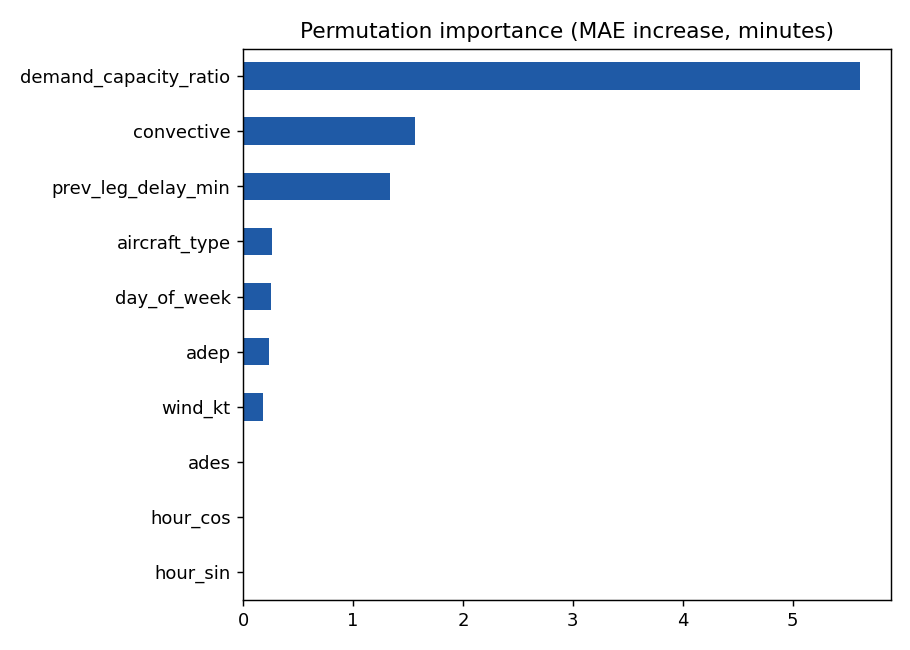
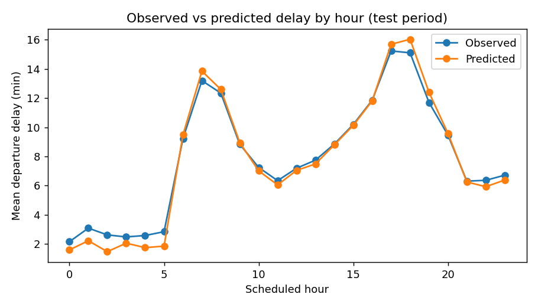

# ATFM Departure Delay Predictor

Machine learning pipeline that predicts **departure delay (minutes)** and the
probability that a flight departs **more than 15 minutes late** at major European
airports. It uses the delay drivers that matter in Air Traffic Flow Management:
demand/capacity imbalance, convective weather, low visibility, wind, and
reactionary (knock-on) delay from the previous leg.



## Results (synthetic dataset, 185k flights, chronological test split)

| Model | MAE (min) | ROC-AUC (delay > 15 min) |
|---|---|---|
| Historical mean per airport & hour (baseline) | 8.40 | 0.711 |
| Gradient boosting (this project) | **4.49** | **0.924** |

The model cuts the baseline error by **~47%**. Permutation importance shows
demand/capacity ratio as the main driver, followed by convective weather and
reactionary delay, which matches the structure of CODA / Network Manager
delay cause reporting (capacity, weather, reactionary).



## Method

1. **Data**: `delay_predictor.data` generates a structurally realistic dataset
   (8 hub airports, hourly traffic banks, summer thunderstorm season, airport
   capacities, aircraft wake categories). Any real dataset in the same schema
   can be passed with `--data`, for example one built from the
   [EUROCONTROL Aviation Data Repository for Research](https://www.eurocontrol.int/dashboard/rnd-data-archive)
   or [OpenSky Network](https://opensky-network.org/) flights.
2. **Features**: cyclic hour encoding, peak-hour flag, low-visibility flag,
   categorical encoding of airports and aircraft types.
3. **Validation**: chronological train/test split (train on the past, test on
   the future) to avoid leakage across days.
4. **Models**: `HistGradientBoostingRegressor` (absolute error loss, robust to
   delay outliers) and `HistGradientBoostingClassifier` for the 15-minute
   punctuality threshold, both compared to a historical-mean baseline.
5. **Explainability**: permutation importance on the test period.

## Usage

```bash
python -m venv .venv && source .venv/bin/activate
pip install -r requirements.txt
PYTHONPATH=src python -m delay_predictor.cli            # synthetic data
PYTHONPATH=src python -m delay_predictor.cli --data my_flights.csv
PYTHONPATH=src pytest -q                                # tests
```

Outputs land in `reports/` (`metrics.json`, plots, trained model).

## Data schema

`flight_id, date, adep, ades, aircraft_type, wake_cat, sched_hour, day_of_week,
month, planned_flight_time_min, demand_capacity_ratio, wind_kt, visibility_m,
convective, prev_leg_delay_min, dep_delay_min`

## Limitations and next steps

- Results above are on synthetic data; numbers on real data will differ.
- Add METAR/TAF parsing for real weather features.
- Add ATFM regulation data (regulated sector, reason code) as features.
- Quantile regression to give delay ranges, not only point estimates.

## Project structure

```
src/delay_predictor/
  data.py    dataset generation, loading and schema validation
  model.py   features, chronological split, models, evaluation
  cli.py     training entry point, reports and plots
tests/       pytest suite (schema, leakage, model vs baseline)
```
